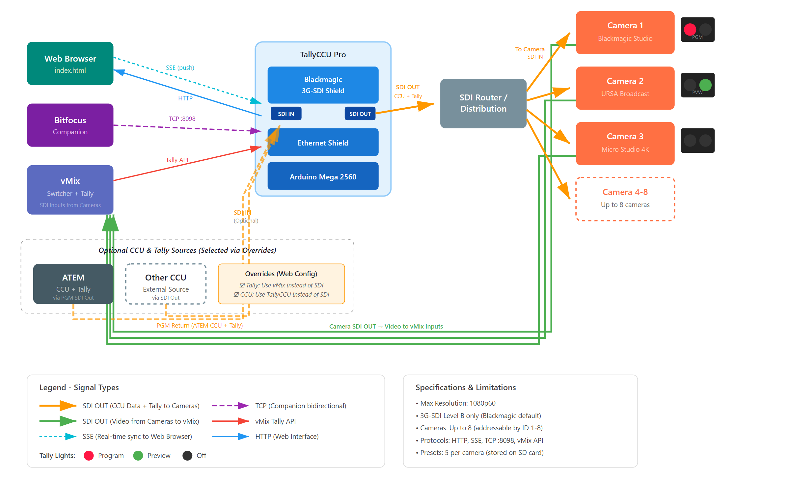
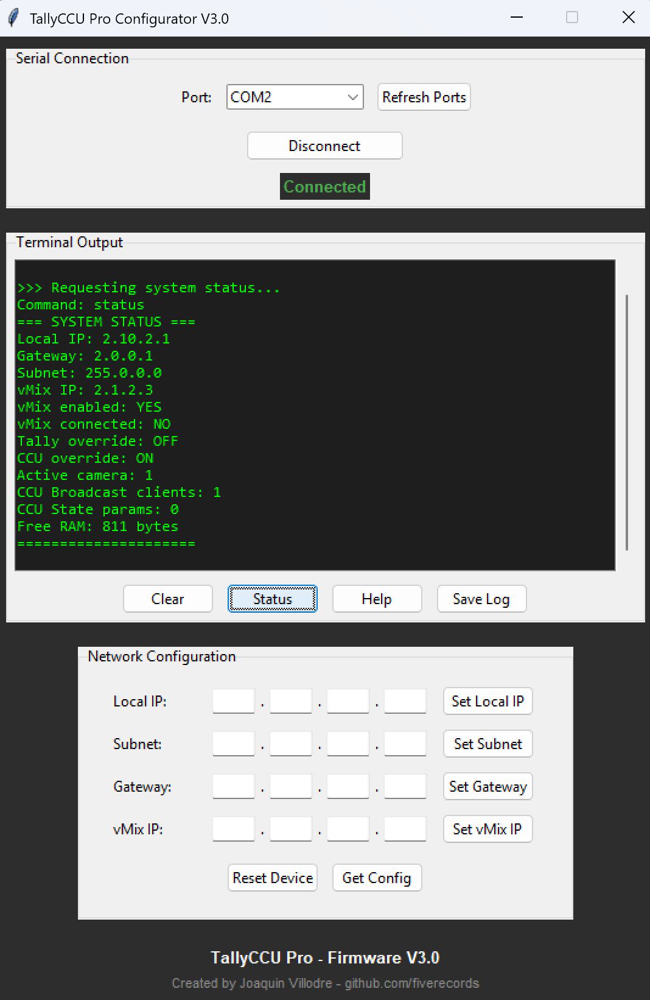
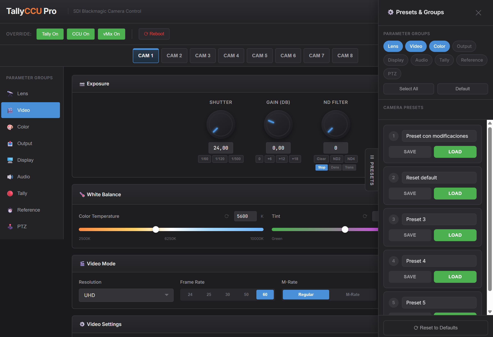
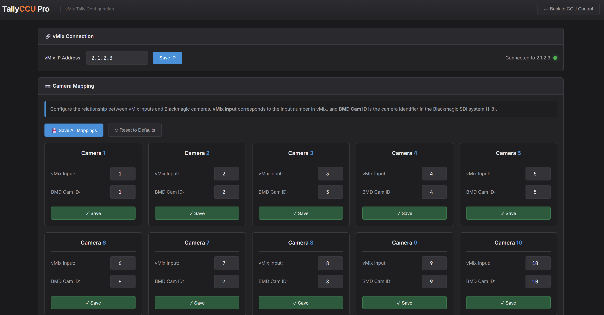
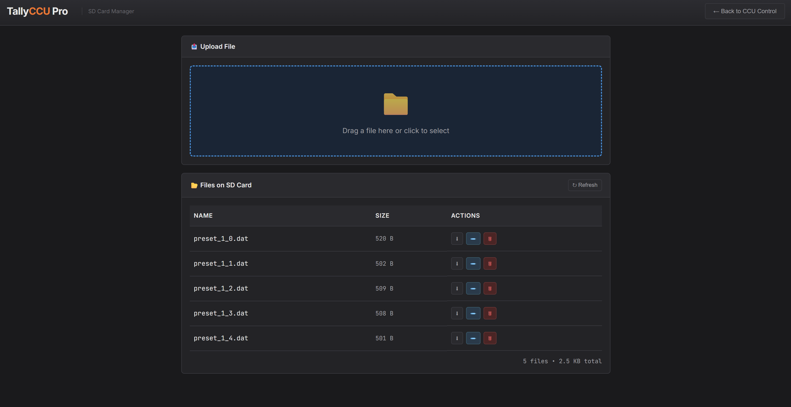

# TallyCCU Pro


<p align="center">
  <strong>Open-source CCU control system for Blackmagic Design cameras with vMix tally integration using the Blackmagic Arduino SDI Shield</strong>
</p>

TallyCCU Pro is an Arduino-based solution that provides full Camera Control Unit (CCU) functionality for Blackmagic cameras via SDI using the Blackmagic Arduino SDI Shield, along with real-time tally light integration with vMix. Control your cameras from a web browser, Bitfocus Companion, or build your own integration using the TCP API.

---

## Features

### Camera Control
- **Full CCU Parameters**: Iris, focus, zoom, white balance, ISO, shutter, ND filters
- **Color Correction**: Lift, gamma, gain, offset with visual color wheels
- **Display Settings**: Zebra, peaking, focus assist, LUT selection
- **Audio Control**: Mic levels, headphone mix, phantom power
- **PTZ Support**: Pan/tilt velocity and memory presets (for supported cameras)

### Tally System
- **vMix Integration**: Automatic tally lights from vMix program/preview state
- **Flexible Mapping**: Map any vMix input to any camera ID
- **Adjustable Brightness**: Independent front/rear tally brightness control

### Connectivity
- **Web Interface**: Full control from any browser on your network
- **Companion Module**: Stream Deck integration via Bitfocus Companion
- **TCP API**: Real-time bidirectional sync on port 8098
- **Serial Configuration**: Initial setup without network access

### Real-Time Synchronization (v3.5+)
- **Server-Sent Events (SSE)**: Instant parameter sync between web interface and Companion
- **Bidirectional Sync**: Changes in Companion appear instantly in the web interface and vice versa
- **Per-Camera State**: Browser maintains state for all 8 cameras, enabling seamless switching
- **Automatic State Recovery**: When either client connects, it receives current state from the other
- **Live Preset Updates**: Preset names sync instantly across all interfaces

### Safe Mode Recovery (v3.7+)
- **Automatic Boot Loop Detection**: System detects consecutive boot failures
- **Safe Mode**: After 3 failed boots, system starts without SDI Shield initialization
- **Diagnostic Web Interface**: Access troubleshooting page at device IP when in Safe Mode
- **Network Access Preserved**: Diagnose issues from the web page, change the vMix IP and tally map, and keep Companion connected (the Arduino IP, mask and gateway are changed by serial only)
- **One-Click Recovery**: Restart in normal mode from the web interface after fixing the issue

### Preset System
- **Save/Load Presets**: Store complete camera configurations
- **Per-Camera Presets**: 5 presets per camera, stored on SD card
- **Group Selection**: Choose which parameter groups to include in presets




---

## Hardware Requirements

| Component | Model | Notes |
|-----------|-------|-------|
| Microcontroller | **Arduino Mega 2560** | Must be Mega (not Uno) due to memory requirements |
| Network | **Arduino Ethernet Shield 2** | W5500 chipset (8 sockets), includes SD card slot. W5100 shields are not supported (4 sockets are not enough) |
| SDI Interface | **Blackmagic 3G-SDI Shield** | For Arduino, directly from Blackmagic |
| Storage | **MicroSD Card** | 1-32GB, must be formatted correctly (see below) |
| Power | **9-12V DC Power Supply** | Required - USB power alone is insufficient |

### Shield Stacking Order

```
        +---------------------+
    3   |  Blackmagic SDI     |  <- Top
        +---------------------+
    2   |  Ethernet Shield    |  <- Middle  
        +---------------------+
    1   |  Arduino Mega 2560  |  <- Bottom
        +---------------------+
```


### CRITICAL: I2C Bridge Wires Required

The Blackmagic SDI Shield is designed for Arduino Uno, which has I2C pins at A4/A5. The Arduino Mega has I2C on different pins (20/21), so you MUST add two jumper wires on the **Blackmagic SDI Shield**:

```
Bridge connections on SDI Shield:
  - A4 --> SDA  (Mega pin 20)
  - A5 --> SCL  (Mega pin 21)
```

On the Uno layout A4 is SDA and A5 is SCL; on the Mega, SDA is pin 20 and SCL is pin 21. Do not cross them: with SDA and SCL swapped the shield (I2C address 0x6E) does not respond and there is no tally or CCU.

These bridges route the I2C signals to the correct pins. Without them, the SDI shield will not communicate with the Arduino Mega.

### CRITICAL: External Power Required

The system requires external power (9-12V DC) connected to the Blackmagic SDI Shield's power input. USB power alone does not provide enough current and the system will fail to boot properly.

> **Note**: Starting with v3.7, if the system detects repeated boot failures (e.g., due to missing 12V power or invalid SDI signal), it will automatically enter Safe Mode. See [Safe Mode](#safe-mode) for details.

---

## SD Card Setup

### Partition and Format Requirements

The SD card MUST meet these requirements:

1. **MBR Partition Table** (not GPT) - Windows and Mac sometimes create GPT partitions
2. **Single Partition** - Only one partition on the card
3. **Correct Filesystem**:
   - Cards 2GB or smaller: FAT16
   - Cards 4GB or larger: FAT32
   - **exFAT will NOT work**

### Recommended Formatting Procedure

**Do NOT use Windows Explorer or Mac Disk Utility** - they may create incompatible partition tables.

Use the official SD Card Formatter from the SD Association:
1. Download from: https://www.sdcard.org/downloads/formatter/
2. Select your SD card
3. Choose "Overwrite format" (not quick format)
4. Format the card

If you still have issues, use the SdFormatter sketch included in the SdFat library examples.

### Copy Web Interface Files

After formatting, copy these files to the SD card root:

```
SD Card Root/
├── index.html      (Main CCU interface)
├── tally.html      (Tally configuration)
├── sdcard.html     (SD Card File manager)
└── safemode.html   (Safe Mode diagnostics - v3.7+)
```

**Optional, recommended (v3.8+): compressed pages.** Run `python3 tools/gzip_sdcard.py` and copy the generated `.gz` files next to the `.html` files (for example `index.html.gz`). The firmware serves the compressed copy to browsers that accept gzip: `index.html` goes from ~210 KB to ~44 KB, so the page loads about 5x faster and keeps the Arduino busy for much less time. Regenerate the `.gz` files every time you update the `.html` files (`python3 tools/gzip_sdcard.py --check` tells you if any is stale). Pages can only be replaced by uploading them in the SD Card Manager; the upload removes the page's old `.gz` (the plain page is served until you copy a new `.gz`). Pages and their `.gz` cannot be renamed or deleted from the web.

---

## Installation

### Step 1: Hardware Assembly

1. Stack shields in order: Mega -> Ethernet -> SDI Shield
2. **Add I2C bridge wires**: A4 to SDA (Mega pin 20), A5 to SCL (Mega pin 21)
3. Insert formatted SD card into Ethernet Shield slot
4. Connect 9-12V power supply to SDI Shield
5. Connect SDI output to your camera(s)

### Step 2: Arduino Firmware

**Required Libraries** (install via Arduino Library Manager; these are the versions the firmware is built and tested with):
- `SdFat` by Bill Greiman, **2.3.1**
- `Ethernet` by Arduino, **2.0.2** (bundled with the IDE; check the version in the Library Manager)
- Board package **Arduino AVR Boards 1.8.6** (`arduino:avr`)

**Blackmagic Library** (manual install):
1. Download from Blackmagic website (included with Desktop Video software)
2. Copy to Arduino libraries folder

The repository's `tests/stubs/BMDSDIControl` is only a compile stub for CI: it does not drive the shield, so never use it for a board you flash.

Every release on [GitHub Releases](https://github.com/fiverecords/TallyCCUPro/releases) has a `TallyCCUPro-<version>.zip` with the firmware, the web pages (with their `.gz` copies) and the tools, plus `TallyCCU_Configurator.exe`.

**Upload Firmware**:
1. Open `firmware/TallyCCUPro/TallyCCUPro.ino` in Arduino IDE
2. Select Board: `Arduino Mega or Mega 2560`
3. Select Port: Your Arduino's COM port
4. Click Upload

### Step 3: Initial Network Configuration

#### Default settings

A new board (blank EEPROM) starts with:

| Setting | Default |
|---------|---------|
| Arduino IP | `192.168.0.100` |
| Subnet mask | `255.255.255.0` (/24) |
| Gateway | `192.168.0.1` |
| vMix IP | `192.168.0.140` (vMix TCP API, port 8099) |
| Web interface | port 80 |
| TCP API (Companion) | port 8098 |
| Tally override, CCU override, vMix connect | ON |
| Serial | 115200 baud |

If your PC is on `192.168.0.x`, you can open `http://192.168.0.100/` right away and set the vMix IP and tally map from the web page. The Arduino IP, mask and gateway are only changed by serial. An Arduino or vMix IP whose first octet is 0 or 255 is taken as unset and replaced by the default, so those addresses cannot be used. The serial command `factoryreset yes` goes back to these defaults (the MAC address is kept).

#### Serial configuration

Connect via serial monitor (115200 baud) or use the Serial Configurator tool:



*(Screenshot of the V3.0 configurator; its free RAM figure is not representative, see [Memory Usage](#memory-usage).)*

- **Windows**: run `TallyCCU_Configurator.exe`. Download the current one from the [latest release](https://github.com/fiverecords/TallyCCUPro/releases/latest): the copy in `tools/` is older and resets the Arduino when it connects.
- **Any OS**: `pip install -r tools/requirements.txt` (pyserial; Python 3 with tkinter), then `python3 tools/TallyCCU_Configurator.py`.

> Opening the serial port can restart the Arduino (the USB adapter's DTR line pulses its reset pin). The configurator avoids it where the OS allows (see the notes at the top of `tools/TallyCCU_Configurator.py`); do not connect a serial monitor to a board that is on air.

```
Available commands:
  help                    Show all commands
  status                  Show current configuration
  ip 192.168.0.100        Set Arduino IP address
  subnet 255.255.255.0    Set subnet mask
  gateway 192.168.0.1     Set gateway (0.0.0.0: none)
  vmixip 192.168.0.140    Set vMix computer IP
  mac [XX:XX:XX:XX:XX:XX] Show or set the MAC address (applies after reset)
  tally                   Show the tally map
  state                   Show the real-time sync (SSE) state
  ram                     Show free RAM
  reset                   Restart Arduino
  safemode                Restart now into Safe Mode
  normalboot              Leave Safe Mode (restarts)
  factoryreset yes        Factory settings (asks to confirm without "yes")
```

### Step 4: Verify Installation

1. Open browser: `http://YOUR_ARDUINO_IP/`
2. You should see the CCU Control interface
3. Select a camera and adjust parameters to test

---

## Web Interface

Access at `http://YOUR_ARDUINO_IP/`

> **Note**: Always use `http://` explicitly. Some modern browsers default to HTTPS, which is not supported. See [Limitations](#limitations).

### CCU Control (index.html)

The main control interface featuring:
- **Camera Selector**: Switch between cameras 1-8
- **Parameter Groups**: Lens, Video, Audio, Color Correction, Display, Tally, PTZ
- **Color Wheels**: Visual lift/gamma/gain/offset adjustment
- **Sliders**: Precise control with step buttons and reset
- **Presets**: Save and load 5 presets per camera
- **Real-Time Sync**: Changes from Companion appear instantly via SSE
- **Tally on the camera buttons** (v3.8+): program in red, preview in green, from vMix; actions that change a camera on air ask first
- **Touch Support**: Full touch control on tablets and phones (v3.7.1+)


### Tally Configuration (tally.html)

- **vMix IP**: Address of computer running vMix
- **Input Mapping**: Map vMix inputs to camera IDs
- **Connection Status**: Real-time indicator


### SD Card Manager (sdcard.html)

- **Upload**: Drag and drop files
- **Download**: Backup presets
- **Delete/Rename**: File management


---

## Safe Mode

Safe Mode is a recovery feature introduced in v3.7 that helps diagnose and recover from hardware-related boot failures.

### When Does Safe Mode Activate?

The system enters Safe Mode automatically after **3 consecutive boot failures**. Common causes:

1. **Missing 12V Power**: SDI Shield requires external 12V power
2. **Invalid SDI Signal**: 4K signals or Level A 3G-SDI are not supported
3. **SDI Cable Disconnected**: No signal during boot
4. **I2C Bus Conflict**: Missing or incorrect bridge wires

### What Works in Safe Mode?

| Feature | Status |
|---------|--------|
| Web Interface | ✓ Available (diagnostic page) |
| Network Configuration | ⚡ vMix IP and tally map from the web; Arduino IP, mask and gateway by serial only |
| vMix Tally Connection | ✓ Receive only (no SDI output) |
| Companion TCP | ✓ Available |
| Serial Console | ✓ Available |
| **SDI Tally Output** | ✗ Disabled |
| **CCU Camera Control** | ✗ Disabled |

### Exiting Safe Mode

1. **Fix the underlying issue** (connect 12V power, valid SDI signal, etc.)
2. Access the diagnostic page at `http://YOUR_ARDUINO_IP/`
3. Click **"Restart Normal Mode"**
4. The system will restart and attempt normal boot

Alternatively, use the serial command `normalboot` to exit Safe Mode.

**Without the SD card (newer than v3.8.1)**: if the card is missing or cannot be read, or `safemode.html` is not on it, `http://YOUR_ARDUINO_IP/` shows a small built-in page instead, with the reason, the last reset, the firmware version and a **Restart in normal mode** button. v3.8.1 and older answer `404` or `503` there; `normalboot` on the serial console works in every version.

**Automatic recovery (v3.8+)**: in Safe Mode the firmware checks the SDI shield on I2C every 5 s. When the shield has answered for 30 s in a row (for example, the 12 V supply came back), the board restarts in normal mode by itself. If that normal boot fails again, the next automatic attempt waits 5 minutes, and after 2 failed attempts automatic recovery stays off until Safe Mode is left by hand or a normal boot completes again (for example after a power cycle). Note that the check only shows that the shield is powered: problems caused by the SDI input (no signal yet, 4K, Level A) are not detected beforehand.

### Manual Safe Mode Entry

For testing or troubleshooting, you can force Safe Mode:
- Serial command: `safemode`
- The board restarts at once into Safe Mode, without automatic recovery, until `normalboot`, "Restart Normal Mode" or the next reset or power cycle (which tries a normal boot)

---

## Bitfocus Companion Module

TallyCCU Pro is available as an **official Bitfocus Companion module**, so you can install it directly from within Companion — no manual setup required.

### Installation

1. Open Bitfocus Companion (v4 or later)
2. Go to the **Connections** tab
3. Click **Add connection**
4. Search for **"TallyCCU Pro"** (or *Fiverecords*)
5. Add the connection and configure it with your Arduino's IP address

### Actions Available

- All CCU parameters (set/increase/decrease/reset)
- Load/Save presets
- Change active camera
- vMix connection toggle

### Real-Time Sync

The Companion module automatically syncs with the web interface:
- Parameters changed in Companion are instantly reflected in the web UI
- Parameters changed in the web UI are instantly reflected in Companion variables
- When either client connects, it receives the current state from the other

---

## TCP Protocol (Port 8098)

For custom integrations, connect via TCP to port 8098.

### Commands (send to Arduino)

```
SUBSCRIBE                       Subscribe to real-time updates   -> SUBSCRIBED OK
                                (Companion sends "SUBSCRIBE CCU")
UNSUBSCRIBE                     Stop the updates                 -> UNSUBSCRIBED OK
PING                            Keep-alive                       -> PONG
STATUS                          Connection status                -> STATUS slot=<n> clients=<n> sub=<0|1>
CCUSYNC <cameraId> <paramKey> <value>
                                Cached parameter, forwarded to the browsers (SSE);
                                no answer. Dropped if the camera (1-8), key or value is invalid
```

### Events (from Arduino to subscribed clients)

```
CCU <cameraId> <paramKey> <value>           Parameter changed (web, Companion or preset)
PRESET <cameraId> <presetId> <name>         Preset loaded
PRESETSAVED <cameraId> <presetId> <name>    Preset saved
REQUESTSYNC                                 A browser connected: send your cached state as CCUSYNC
```

Other lines from the Arduino: `CCUSERVER OK TallyCCU-Pro` (on connect), `ERROR Server full`, `ERROR Line too long`, `ERROR Unknown command`. Camera parameters are set over HTTP (`GET /?cameraId=N&<paramKey>=<value>`), not on this port.

### Connection Rules (v3.8+)

- On connect the server sends `CCUSERVER OK TallyCCU-Pro` at once, without waiting for the client. Up to 2 clients; a third gets `ERROR Server full` and is closed.
- A client must send `SUBSCRIBE` within 10 s of connecting, and once subscribed must send something (a `PING` is enough) at least every 90 s, or it is disconnected. Companion subscribes at once and sends `PING` every 30 s.
- A new connection from the same IP replaces an older one from that IP only if the older one has been silent for 35 s (a stale reconnect), so a script and Companion on the same PC can both stay connected while both send `PING`.
- Lines end with `\n` (`\r` is ignored) and may be split across TCP segments. Maximum 127 characters per line; a longer line is dropped whole and answered with `ERROR Line too long`. Unknown commands get `ERROR Unknown command`. Outgoing lines never contain control characters.
- Commands are processed up to 8 per loop pass, none dropped: large `CCUSYNC` dumps are spread over several passes. `REQUESTSYNC` is sent at most every 10 s.
- Events are never allowed to block the Arduino: if a client stops reading, events for it are dropped, and a client that stays blocked for 5 s is disconnected.
- There is no authentication (see [Security](#security)). To restrict the port to known hosts, define `CCU_ALLOWED_HOSTS` in `CCUBroadcast.h` (off by default).

---

## Architecture

### Synchronization Flow

```
┌─────────────┐         ┌─────────────┐         ┌─────────────┐
│   Web UI    │◄──SSE───│   Arduino   │◄──TCP───│  Companion  │
│  (Browser)  │───POST─►│  (Mega2560) │───TCP──►│   Module    │
└─────────────┘         └─────────────┘         └─────────────┘
      │                        │                       │
      │   cameraStates[]       │                       │   cameraStates{}
      │   (per-camera)         │                       │   (per-camera)
      └────────────────────────┴───────────────────────┘
                    Bidirectional Real-Time Sync
```

- **SSE (Server-Sent Events)**: Arduino pushes changes to web interface instantly, plus the vMix tally of the cameras and the Tally/CCU/vMix switches (v3.8+) when they change and on connect
- **TCP Broadcast**: Arduino pushes changes to Companion module
- **POST /syncState**: Web sends cached state to Arduino for TCP broadcast
- **REQUESTSYNC**: Arduino requests state from connected clients on new connections

### Safe Mode Boot Flow (v3.7+)

```
Power on / reset
    │
    ▼
SafeMode::begin()  (first thing in setup())
    │
    ▼
┌──────────────────────────────┐
│ Did the previous boot hang   │──NO──► Counter = 0 ──► Normal boot
│ (watchdog or crash) before   │        (power cut, reset button, web /reboot
│ completing (20 s of uptime)? │         and serial reset do not count)
└──────────────┬───────────────┘
               │YES
               ▼
         Counter + 1
               │
               ▼
┌───────────────────┐
│ Counter >= 3?     │──NO──► Normal boot
└────────┬──────────┘
         │YES
         ▼
    SAFE MODE
    - Skip SDI Shield init
    - Network/Web only
    - Serve diagnostic page
    - Probe the shield every 5 s: after 30 s of answers, restart in normal mode
```

One exception: until the board has been reset once with the power on (reset button, `/reboot`, serial `reset`), a power cut during the first 20 s also counts, because the firmware cannot yet tell it from a hang.

Safe Mode lasts until the next reset: a power cycle, the web `/reboot` or the serial `reset` tries a normal boot again, and 3 more failed boots are needed to return to Safe Mode. The serial command `safemode` enters Safe Mode directly, without the automatic recovery.

---

## Project Structure

```
TallyCCUPro/
├── firmware/
│   └── TallyCCUPro/      Arduino sketch (folder name must match the .ino)
│       ├── TallyCCUPro.ino   Main sketch (setup, loop, serial commands)
│       ├── CCUControl.*      Camera control
│       ├── CCUBroadcast.*    TCP server, port 8098
│       ├── TallyManager.*    Tally light control
│       ├── VmixConnector.*   vMix integration
│       ├── webserver.*       HTTP & SSE server
│       ├── Network.*         Ethernet setup, IP configuration
│       ├── NetUtils.*        Non-blocking network I/O helpers (v3.8+)
│       ├── Storage.*         EEPROM management
│       ├── SdUtils.*         SD card operations
│       ├── SafeMode.*        Boot failure recovery (v3.7+)
│       ├── bmd_params.*      Blackmagic protocol definitions
│       └── Configuration.h   Pins, limits, EEPROM map
├── sdcard/               Web interface files
│   ├── index.html        Main CCU interface
│   ├── tally.html        Tally configuration
│   ├── sdcard.html       File manager
│   └── safemode.html     Safe Mode diagnostics (v3.7+)
├── tools/
│   ├── TallyCCU_Configurator.py    Serial configurator (Python, pyserial)
│   ├── TallyCCU_Configurator.spec  PyInstaller recipe for the .exe
│   ├── TallyCCU_Configurator.exe   Windows build (old; current one in the releases)
│   ├── gzip_sdcard.py              Builds the .gz copies of the pages
│   └── requirements*.txt           Python dependencies (run / build the .exe)
├── tests/                Emulator, scenarios, host unit tests, Companion harness (see Testing)
├── .github/workflows/    CI and release workflows
├── docs/                 Code audit report, release notes (docs/release-notes/)
└── README.md
```

---

## Memory Usage

TallyCCU Pro is optimized for Arduino Mega's limited 8KB RAM:
- Static buffers (no String objects, no heap)
- SSE-based sync (state stored in browser, not Arduino)
- Parameter table and fixed strings kept in flash (PROGMEM) since v3.8
- Static RAM in v3.8: about 3.5 KB of 8 KB (v3.7.1: about 6.0 KB), leaving about 4.6 KB for the stack; worst-case stack depth is about 1 KB (pessimistic call-graph bound about 1.3 KB)
- These figures are `.data` + `.bss` + `.noinit` (the "global variables" of the Arduino IDE) measured with the compile stub of the Blackmagic library (`tests/stubs`); the real library adds its own. CI reports them on every commit and fails above 4600 B (see [Testing / CI](#testing--ci)). The serial command `ram` shows the free RAM and the lowest value reached since boot

---

## Security

TallyCCU Pro is meant for a closed production network. Read this before connecting it to a network that other people or devices use.

- **No authentication.** The web interface, the HTTP API and TCP port 8098 accept commands from any device that can reach the Arduino. Anyone on that network can move cameras, change the tally map or the vMix IP, delete files on the SD card or restart the board.
- **CSRF protection (v3.8+).** Requests that change settings or files must carry the header `X-TallyCCU: 1`; without it they get `403 ERROR forbidden` and nothing is changed. A web page open in a browser on the same network cannot add that header to a request to the Arduino (the browser would first need a CORS preflight, which the Arduino never accepts), so a malicious or compromised site cannot use your browser to restart the board, delete files or change the tally and vMix settings. Responses carry no `Access-Control-Allow-Origin` header, so other sites cannot read them either, and the real-time stream (`/events`) refuses requests that the browser marks as coming from another site or origin (`Sec-Fetch-Site`).
  - Protected: `GET /reboot`, `POST /safemode-exit`, `/?deleteFile=`, `/?renameFile=`, `POST /upload`, `/?overrideTally=`, `/?overrideCCU=`, `/?vmixIP=`, the tally map (`tallyCam<N>Input`, `cam<N>ID`) and `POST /syncState`.
  - Not protected, so that the official Companion module keeps working unchanged: camera commands (`/?cameraId=N&<param>=<value>`), `/?loadPreset=`, `POST /savePreset`, `/?listPresets`, `/?vmixConnect=`, every read-only request, `/events` and the pages. A malicious page in a browser on that network could therefore still send camera commands or load presets.
- **Your own scripts** must send the header for the protected requests:
  ```bash
  curl -H 'X-TallyCCU: 1' 'http://192.168.0.100/?overrideTally=1'
  curl -H 'X-TallyCCU: 1' 'http://192.168.0.100/?tallyCam0Input=1&cam0ID=1'
  curl -H 'X-TallyCCU: 1' -F 'file=@preset_1_0.dat' 'http://192.168.0.100/upload'
  curl -H 'X-TallyCCU: 1' 'http://192.168.0.100/reboot'
  curl 'http://192.168.0.100/?cameraId=1&gain_db=6'      # camera commands need nothing
  ```
- The header is not a password: any device on the network can send it. **Keep the Arduino, the vMix PC and the Companion machine on an isolated production network or VLAN**, with no guest or public Wi-Fi access, and avoid browsing the internet from the computers that control it (or use a separate browser for it). Port 8098 can be limited to known hosts with `CCU_ALLOWED_HOSTS` in `CCUBroadcast.h`. There is no HTTPS: all traffic is clear text.

---

## Limitations

### No Authentication
Anyone who can reach the Arduino on the network can control it. See [Security](#security).

### HTTPS Not Supported
The Arduino Mega cannot handle HTTPS connections due to hardware limitations (insufficient RAM and CPU for TLS encryption). Always use `http://` when accessing the web interface.

> **Tip**: If your browser defaults to HTTPS and shows a connection error, manually type `http://` before the IP address.

### SDI Shield Resolution & Signal Limitations
The Blackmagic 3G-SDI Arduino Shield has the following limitations:
- **Maximum resolution**: 1080p60 (no 4K/UHD support)
- **3G-SDI Level B only**: The shield only passes video when using 3G-SDI Level B. This is the default for Blackmagic devices, but other manufacturers may default to Level A. Check your camera/device settings if video is not passing through.

### Two SSE Clients
Up to 2 browsers (tabs or devices) receive real-time sync at the same time (v3.8+). A third one replaces the oldest, which reconnects on its own. A newly opened tab may take up to 10 s to receive the current state from Companion.

### Network Connections
The W5500 (Ethernet Shield 2) has 8 sockets (a W5100 has only 4, which is why it is not supported), shared between:
- the HTTP listeners (port 80: two while at least 3 sockets are free, else one) and the TCP listener (port 8098)
- the vMix connection (tally)
- up to 2 SSE clients (browsers)
- up to 2 TCP clients on port 8098 (Companion, custom integrations)
- HTTP requests being served

Connections to port 80 that do not send a request within 5 s are closed, so idle or half-open connections cannot use up the sockets.

Pages and files are sent in the background (v3.8+): while a slow client downloads a page (for example a tablet on poor Wi-Fi), camera commands, the API, tally and the PTZ safety stop are answered at once. Up to 2 transfers run at a time; a third page or file request waits for a free slot for up to 35 s, or gets `503` (`Retry-After: 2`) after 10 s when sockets are short (for example with two browsers on the real-time sync). A transfer is cut after 5 s plus its size at 8 KB/s (at most 30 s), or after 5 s without progress; it ends with a FIN, or the connection is closed if the reader takes nothing at all.

### Camera Protocol
The Blackmagic SDI protocol is **write-only** - parameters can be sent to cameras but not read back. The system cannot query current camera settings; it only knows values that were set through TallyCCU Pro.

---

## Troubleshooting

| Problem | Solution |
|---------|----------|
| Web interface not loading | Verify SD card is MBR/FAT16 or FAT32, reformat with SD Association tool |
| SDI shield not responding | Check I2C bridge wires (A4→SDA / pin 20, A5→SCL / pin 21 on SDI shield) |
| System not booting | Connect external 9-12V power, USB is insufficient |
| System stuck in boot loop | Check 12V power and SDI signal; after 3 failures, Safe Mode activates automatically |
| Safe Mode activated | Fix hardware issue (12V power, valid SDI signal), then click "Restart Normal Mode" |
| vMix tally not working | Verify vMix IP in tally.html, check vMix TCP API is enabled |
| Camera not responding | Verify camera ID matches, check SDI connection and termination |
| Browser shows HTTPS error | Type `http://` explicitly before the IP address |
| Sync not working | Ensure both web and Companion are connected; check serial monitor for SSE status |
| Settings reset after reboot | Resolved in v3.5+; update firmware if running an older version |
| Controls not working on tablet | Requires v3.7.1+ which adds touch support for knobs, wheels, and joystick |
| Own script gets `403 ERROR forbidden` | Add the header `X-TallyCCU: 1` to that request (see [Security](#security)) |
| Serial configurator restarts the Arduino | Use the `.exe` of the latest release or the `.py`, not the old `.exe` in `tools/`; see Step 3 |

---

## Building from Source

### Firmware

With the Arduino IDE, see [Step 2](#step-2-arduino-firmware). With `arduino-cli` and the same versions as CI:

```bash
arduino-cli core install arduino:avr@1.8.6
arduino-cli lib install Ethernet@2.0.2 SdFat@2.3.1
# plus the Blackmagic BMDSDIControl library in your sketchbook libraries folder
arduino-cli compile -b arduino:avr:mega firmware/TallyCCUPro
```

### Serial Configurator (.exe)

`TallyCCU_Configurator.exe` is built from `tools/TallyCCU_Configurator.py` with PyInstaller and the recipe `tools/TallyCCU_Configurator.spec` (one file, no console, with the icon). On Windows with Python 3.12, from the repository folder in a Command Prompt (`cmd.exe`):

```bat
python -m pip install -r tools/requirements-build.txt
set PYTHONHASHSEED=0
python -m PyInstaller --clean --noconfirm tools/TallyCCU_Configurator.spec
rem -> dist\TallyCCU_Configurator.exe
```

In PowerShell, replace the `set` line with `$env:PYTHONHASHSEED='0'`; in Git Bash, run `PYTHONHASHSEED=0 python -m PyInstaller --clean --noconfirm tools/TallyCCU_Configurator.spec`. PyInstaller needs a fixed `PYTHONHASHSEED` to give the same `.exe` from the same source and tool versions.

The release workflow builds it the same way for every version and attaches it to the [GitHub release](https://github.com/fiverecords/TallyCCUPro/releases), with its SHA-256 in `SHA256SUMS.txt`, so each `.exe` can be traced to the source of its tag. The `.exe` kept in `tools/` is an older build (it shows V3.0 and resets the Arduino when it connects); prefer the one from the latest release. The `.exe` is not code-signed: Windows SmartScreen may warn the first time.

---

## Testing / CI

Changes can be tested without the hardware. Everything lives in `tests/` (details in [tests/README.md](tests/README.md)):

| Directory | What |
|-----------|------|
| `tests/stubs/BMDSDIControl` | compile-only stub of the Blackmagic library, with the official library's declarations (non-const array writes, `void setCameraTally`) |
| `tests/ci` | AVR build with static RAM limit, web page checks, firmware version in one place |
| `tests/host` | unit tests (g++) of the parsers, NetUtils readers, JSON escaping, tally map, IP validation and factory defaults |
| `tests/emulator` | the unmodified firmware built as a Linux program: emulated W5500, SD, EEPROM, watchdog and SDI shield |
| `tests/scenarios` | robustness scenarios on the emulator: vanishing clients, slow downloads and background transfers, idle sockets, vMix half-open, SD removed, Safe Mode, reset causes, CSRF |
| `tests/companion` | the official Companion module v3.1.0 (unmodified) driving the emulator, and differential runs between two firmware versions |

```bash
tests/emulator/fetch_libs.sh && tests/ci/build_avr.sh    # pinned libraries, AVR build and RAM
BMD_DIR=~/Arduino/libraries/BMDSDIControl tests/ci/build_avr.sh   # same, with the real Blackmagic library
tests/host/run.sh                                        # host unit tests
tests/emulator/build.sh && python3 tests/scenarios/run.py --fast
```

GitHub Actions (`.github/workflows/ci.yml`) runs on every push and pull request:
- firmware build with `arduino-cli` for the Mega 2560 (core 1.8.6, Ethernet 2.0.2, SdFat 2.3.1, BMD stub), with the warnings count and a static RAM limit of 4600 B;
- AVR build with avr-gcc and the host unit tests;
- the fast emulator scenarios (no unintended watchdog reset);
- `node --check` of the scripts in `sdcard/*.html`, and a check that the firmware version is only written in `FIRMWARE_VERSION`;
- the Companion module v3.1.0 against the emulated firmware.

Started by hand (*Actions*, *CI*, *Run workflow*), it can also run every scenario (`full_scenarios`) and the full Companion differential against a reference firmware (`companion_diff`, default reference v3.7.1). Pushing a tag `v*` runs `.github/workflows/release.yml`: CI, the release zip (firmware, pages with `.gz`, tools), the configurator `.exe` and the GitHub release with the notes from `docs/release-notes/<tag>.md`. To change the notes of a published release, edit that file, merge it and run *Actions*, *Release notes*, *Run workflow* with the tag.

---

## Changelog

### Unreleased
- **Fixed**: Safe Mode page without the SD card: when the card is missing or cannot be read, or `safemode.html` is not on it, `/` shows a built-in page with the reason, the last reset, the firmware version and the **Restart in normal mode** button, instead of `404` or `503`. v3.8 announced it, but the page was never served

### v3.8.1 (Latest)
Hotfix for v3.8. Same behaviour on the cameras, tally and Companion as v3.8 (apart from the version number, the firmware compiles to the same machine code).

- **Fixed**: v3.8 did not compile with the official Blackmagic `BMDSDIControl` library (`no matching function for call to ... writeCommandInt8(..., const int8_t [2])`). The library takes list values (for example color correction) as non-const arrays; the stub used by CI accepted const ones, so CI did not see it. The CI stub now copies the official library's declarations, so this kind of mismatch fails CI
- **Fixed**: With firmware older than v3.8, the SD Card Manager listed the `.gz` copies of the system pages (`index.html.gz`...). The page now hides the system pages and their `.gz` by itself (v3.8 firmware already hid them)
- **New**: `tests/ci/build_avr.sh` builds against a real `BMDSDIControl` library with `BMD_DIR=<library folder>`

### v3.8
> ⚠️ v3.8 has a bug and does not compile with the official Blackmagic `BMDSDIControl` library: use v3.8.1, which has all the changes below.

Phases 1 to 3 of the fixes from the full code audit ([docs/AUDITORIA-v3.7.1.md](docs/AUDITORIA-v3.7.1.md)). Compatible with the current Bitfocus Companion module (v3.1.0), checked with differential tests of v3.7.1 vs v3.8 driving the unmodified module.

**Hardening and web interface (phase 3)**
- **New**: Pages and files are sent in the background: while a slow client downloads a page, camera commands, the API, tally and the PTZ stop are answered at once (a Companion-style PTZ stop reaches the camera in about 10 ms in tests). Up to 2 transfers run at a time (see [Network Connections](#network-connections))
- **New**: The camera buttons show the vMix tally (program red, preview green), and loading a preset, changing the video format or resetting to defaults on a camera that is on air asks first
- **Fixed**: The Tally, CCU and vMix buttons follow changes made from another browser or from Companion; a click acts on the state TallyCCU reports, not on what the page last showed
- **Fixed**: The web interface keeps the state of each camera: knobs, sliders, color wheels and multi-value parameters no longer carry over from one camera to another, and a value not known for a camera is shown as unknown instead of the default
- **Changed**: Presets saved from the web hold only the values known for that camera. Reset to Defaults never sends the video format, actions, color bars or the lens position (iris, focus, zoom)
- **Improved**: Iris, focus and zoom knobs have finer steps and send while dragged; typed values are sent; shutter steps follow 50/60 Hz; preset IDs are 0-4 as in Companion; preset overwrite and PTZ memory store/reset are set apart and confirmed; touch fixes
- **New**: CSRF protection: requests that change settings or files need the header `X-TallyCCU: 1` (the pages send it; Companion is not affected), and no response carries `Access-Control-Allow-Origin: *` any more. Own scripts must add the header (see [Security](#security))
- **Fixed**: SD Card Manager: a file name could run a script in the page; system pages and their `.gz` can no longer be deleted or renamed (whatever the case of the name), only replaced by an upload; names up to 47 characters, checked so that they always address the file shown
- **Fixed**: Preset names with `&`, `%`, `+` or commas are stored and shown exactly
- **Fixed**: Malformed `%XX` sequences and cut request lines are rejected instead of applied truncated; JSON and port 8098 lines are escaped, so control characters can no longer break the web page or Companion
- **Changed**: The value echoed to Companion and the browsers is what the camera received (for example `0,0` for an empty field); with the CCU override off, values are no longer echoed as if applied
- **Fixed**: The tally heals itself: each mapped camera gets its tally again every 4 s and a shield that reset gets its settings back; after a restart the first vMix connection uses a new local port, so vMix does not take it for the old one
- **New**: The real cause of the last reset (power on, reset button, restart, watchdog, and where a hang happened) is shown by `status` and the Safe Mode page; only hangs in the first 20 s count as boot failures
- **New**: Serial console: `mac` (show or set the MAC), `factoryreset yes`; `safemode` restarts at once into Safe Mode; commands are case-insensitive, and over-long lines are rejected instead of run truncated. IP settings are validated strictly and report a missing cable or Ethernet chip
- **New**: "Stay in Safe Mode" explains what stays off
- **New**: The EEPROM has a layout header (settings of older versions are kept) and a boot writes it less; low RAM warning from the deepest stack point; static RAM about 3.5 KB
- **New**: The firmware version is written only in `FIRMWARE_VERSION`; the serial configurator reads it from the board (`status`), and `/safemode-status` reports it
- **New**: Tests and CI without the hardware (emulator, robustness scenarios, host unit tests, the official Companion module), pinned library versions, release workflow and a reproducible configurator `.exe` (see [Testing / CI](#testing--ci)); one license (CC BY-NC-SA 4.0) everywhere

**Live stability (phase 2)**
- **Fixed**: A browser, Companion or download client that vanished (Wi-Fi drop, laptop asleep) could freeze the Arduino or trigger a watchdog reboot on air. All network writes are now non-blocking or time-bounded, and responses are sent in blocks instead of one TCP segment per character
- **Fixed**: Tally froze while a page was served or a file uploaded; tally keeps updating during transfers (under 100 ms in tests)
- **New**: vMix heartbeat: a vMix that disappears without closing the connection is detected in ~15 s (tally off, reconnect). Reconnects retry after 2, 2, 5 and 10 s (max 30 s) instead of 20 s+
- **Fixed**: TALLY lines split across TCP packets are applied whole; the current vMix state is re-applied when the tally override or the map changes
- **New**: Tally map slots can be cleared (Clear button in tally.html)
- **Fixed**: Port 8098: proper line handling (long or split lines), large Companion sync dumps processed without blocking, idle connections reclaimed (see Connection Rules)
- **Fixed**: Companion's `timecode_source` action now reaches the camera (its `timecode_source_0` key is accepted)
- **Fixed**: Two browsers no longer kick each other off the real-time sync (2 SSE clients)
- **New**: Optional PTZ/zoom safety stop: the web interface refreshes the speed while the joystick is held, and the firmware stops the motion if refreshes stop for 600 ms (only for the web interface; Companion behaves as before)
- **New**: gzip-compressed pages (`tools/gzip_sdcard.py`), served automatically when present
- **Fixed**: Saving a preset or uploading a file is atomic: an interrupted save keeps the previous file
- **Fixed**: SD card removed or failing: errors are reported (`SD not available`) and the card is remounted automatically
- **New**: Automatic exit from Safe Mode when the shield answers again (see Safe Mode)
- **Fixed**: A stuck I2C bus no longer hangs the Arduino until the watchdog (25 ms I2C timeout)
- **Fixed**: Changing the Arduino IP reconnects vMix with the new address
- **Improved**: Web interface shows rejected commands and a connection/sync indicator, and reconnects the real-time sync if it goes silent
- **Improved**: Serial configurator no longer resets the Arduino when it connects (where the OS allows it); rebuild the `.exe` to get this
- **Improved**: Static RAM down from ~5.8 KB to ~3.6 KB (parameter table moved to flash)

**Phase 1**

**Tally / vMix**
- **Fixed**: Only vMix inputs 1-10 drove tally; any mapped input up to 63 now works
- **Fixed**: Several inputs mapped to the same camera overwrote each other; states are combined and program wins over preview (one input can also drive several cameras)
- **Fixed**: Tally now turns off when the vMix connection is lost, disabled or its IP changes (the 3.7.1 entry below claimed this, but it was not in the code)
- **Fixed**: After a refused vMix connection the firmware kept a stale socket that the web server or Companion could reuse
- **Fixed**: Debounce could leave a stale tally state after a quick B->A change
- **Improved**: vMix connect attempts time out after 250 ms instead of ~1 s, so the loop is not frozen while vMix is down

**Camera control**
- **Fixed**: Exponent values from Companion (e.g. `2.7e-17`) reached the camera as huge numbers; malformed values are now rejected
- **Fixed**: Loading a preset re-ran actions (auto white balance, autofocus, color correction reset); actions are no longer broadcast as parameter state
- **Fixed**: Boolean `true` was applied as false
- **Fixed**: Fixed-point values of 16.0 (e.g. gain adjust max) wrapped to -16.0
- **Changed**: Loading a preset no longer applies pan/tilt or zoom speed (the head could keep moving) or color bars. PTZ memory recall is still applied, but a stored "memory store" is ignored (it overwrote the memory). Video mode is still applied, except the never-set default `60,0,6,0,0` (UHD 60p) that older web presets and the Companion module store
- **Changed**: The web interface no longer stores video mode, actions, motion commands or color bars in presets

**Web server and Safe Mode**
- **Fixed**: Malformed tally map keys could write past a stack buffer
- **New**: Proper HTTP status codes: `400` for invalid parameters, `503` for camera commands in Safe Mode, `404`/`500` for presets. Saving or loading a preset no longer reports success when it fails
- **New**: `getOverrides` reports `ccuAvailable`
- **Fixed**: In Safe Mode, camera commands no longer write to the uninitialized SDI shield

**Boot and network**
- **Fixed**: Boot-loop detection now requires 20 s of stable operation, so hangs right after boot also lead to Safe Mode
- **Fixed**: Web `/reboot` and the serial `reset` command no longer count as boot failures
- **Fixed**: With a blank EEPROM, tally and CCU overrides started OFF; they now default to ON, and the default vMix IP is in the same subnet as the default Arduino IP
- **Fixed**: SPI chip selects are deselected before SD init, and SD init is retried up to 3 times
- **Improved**: Per-parameter, per-command and per-tally serial logs are off by default (`DEBUG_HOT` in `Configuration.h`); a full serial TX buffer was blocking the loop

**Web interface**
- **Fixed**: PTZ joystick and continuous zoom: one request in flight, latest value wins, and the stop command is retried, so the head no longer keeps moving after release
- **Fixed**: The joystick uses Pointer Events and always stops on release, cancel, window blur or tab switch
- **Fixed**: Synced or preset values for multi-value parameters (white balance, input levels, LUT, ND) were reverted by the next local change
- **Fixed**: A preset loaded while switching cameras was shown on the wrong camera
- **Fixed**: Preset save and load show the real result and error message; names are limited to 31 bytes
- **Fixed**: Gain adjust maximum is 15.99
- **Fixed**: Tally page accepts vMix inputs 1-63 and shows server errors

**Project**
- **Changed**: Sketch moved to `firmware/TallyCCUPro/` (Arduino requires the folder to match the `.ino` name)
- **Fixed**: `#include "WebServer.h"` did not match `webserver.h`, breaking builds on case-sensitive file systems (Linux, CI)
- **Fixed**: README I2C bridge wiring: A4 -> SDA (Mega pin 20), A5 -> SCL (Mega pin 21)

### v3.7.1
- **Fixed**: vMix reconnection loop flooding network (now uses progressive backoff)
- **Fixed**: Tally lights stuck ON after vMix disconnect (not actually in the 3.7.1 code; fixed in v3.8)
- **Fixed**: CCU Broadcast TCP buffer truncation (64→128 bytes)
- **Fixed**: Tally mappings not loading from EEPROM on page open
- **Fixed**: SD card deadlock in preset error paths
- **Fixed**: Virgin EEPROM loading invalid network config (255.255.255.255)
- **Fixed**: MAC address generation off-by-one
- **Fixed**: Safe Mode page deletable from SD card manager
- **Fixed**: Filenames with apostrophes breaking SD card manager UI
- **Fixed**: JSON filename escaping in file listing endpoint
- **New**: Touch support for knobs, color wheels, and PTZ joystick (tablet/phone)
- **New**: `getTallyMap` API endpoint for reading stored mappings
- **Improved**: Color wheel drag throttled to ~30fps
- **Improved**: Fetch error handling across entire web interface
- **Improved**: Eliminated unnecessary String allocations in serial commands
- **Improved**: Free RAM ~2,000+ bytes (up from ~1,500 in v3.5)

### v3.7
- **New**: Safe Mode recovery system for boot failures
- **New**: Automatic boot loop detection (enters Safe Mode after 3 consecutive failures)
- **New**: Diagnostic web interface (`safemode.html`) for troubleshooting
- **New**: Serial commands `safemode` and `normalboot` for manual control
- **New**: `/safemode-status` and `/safemode-exit` API endpoints
- **Improved**: TallyManager skips SDI Shield initialization in Safe Mode
- **Improved**: WebServer redirects to diagnostic page when in Safe Mode

### v3.6
- Version bump release

### v3.5
- **New**: Real-time synchronization via Server-Sent Events (SSE)
- **New**: Bidirectional sync between web interface and Companion
- **New**: Live preset name updates across all interfaces
- **Improved**: ~600 bytes RAM freed by moving state to browser
- **Improved**: Faster SSE connection establishment
- **Fixed**: Override settings (Tally/CCU/vMix) persistence bug

### v3.0
- Complete rewrite with modular architecture
- Web-based color correction with visual color wheels
- Companion module with full parameter support
- TCP broadcast for real-time updates

Release notes of each version: [GitHub Releases](https://github.com/fiverecords/TallyCCUPro/releases) (with the firmware zip and the configurator `.exe`) and [docs/release-notes/](docs/release-notes/).

---

## Author

**Joaquin Villodre** - [github.com/fiverecords](https://github.com/fiverecords)

---

## Links

- [Blackmagic SDI Shield](https://www.blackmagicdesign.com/products/blackmagicshield)
- [Bitfocus Companion](https://bitfocus.io/companion)
- [SD Association Formatter](https://www.sdcard.org/downloads/formatter/)

## License

This project is licensed under the Creative Commons Attribution-NonCommercial-ShareAlike 4.0 International License (CC BY-NC-SA 4.0).

You are free to use, modify and redistribute this project for non-commercial purposes, provided that you give appropriate credit and keep derivatives under the same license.

## Disclaimer

This project is not affiliated with, endorsed by, or sponsored by Blackmagic Design or vMix.
Blackmagic Design and vMix are registered trademarks of their respective owners.
